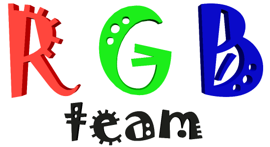
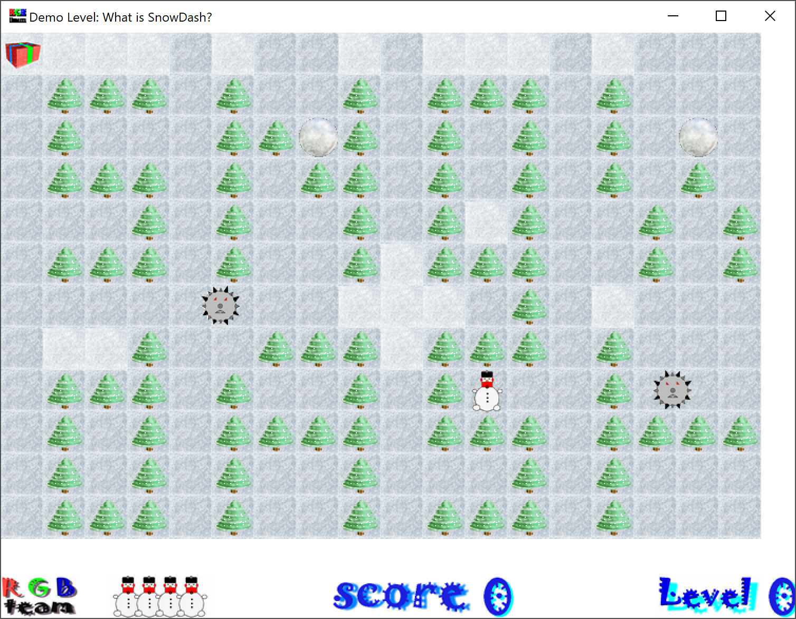
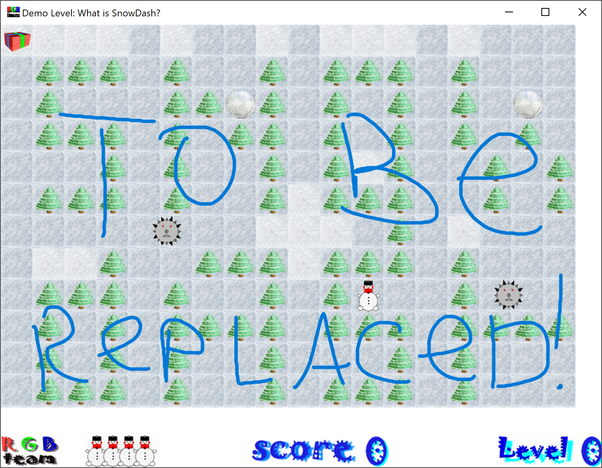
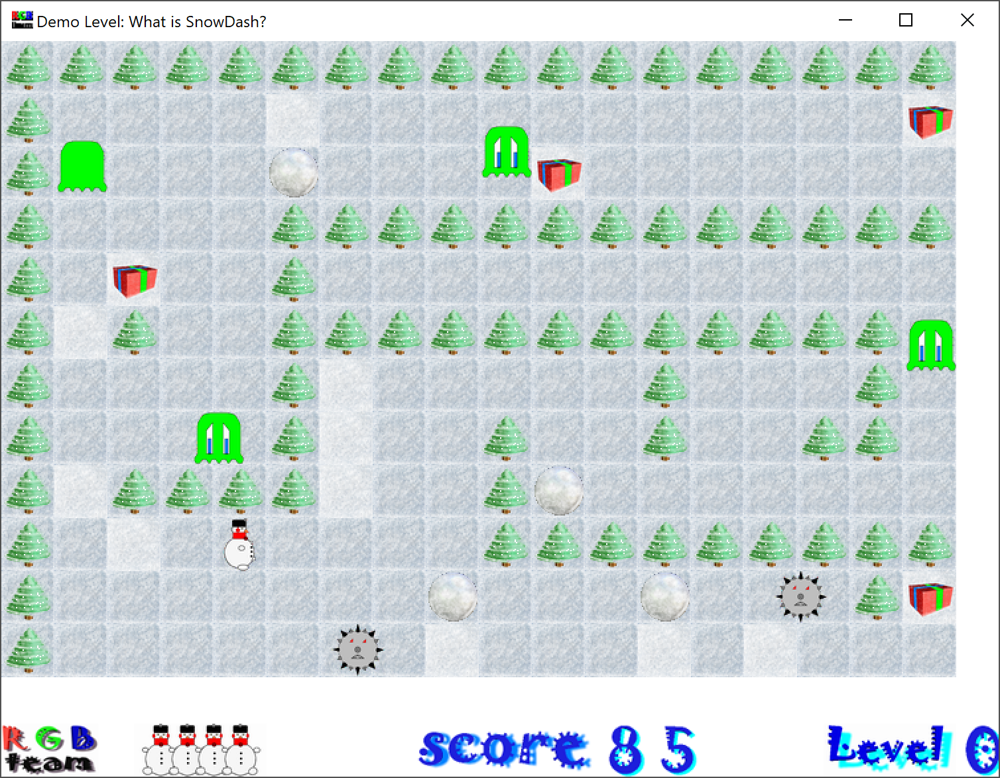
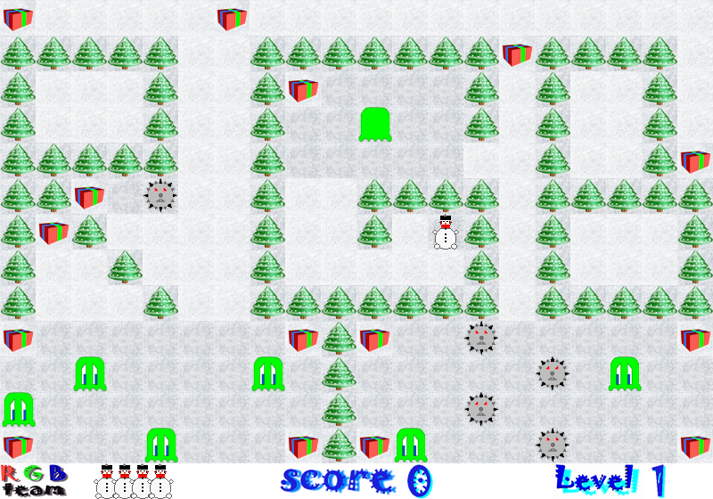

<div align="center">

# ❄️ SnowDash: 20th Anniversary Edition

**A browser port of a 2006 university Win32 C++ arcade game, rebuilt in TypeScript.**

[](https://snowdash20.netlify.app)


**[English](README.md)** | **[Русский](README.ru.md)** | **[Ретро](misc/RETRO.md)**

</div>

---

## 🙋‍♂️ Hi there!

**Димасик** ("B" from ) here 👋

Before you is a special web edition of the super-duper mega-cool game **SnowDash**. It was made by third-year students back in 2006. Since the game became a bit of a meme in narrow circles (and among a certain club of those who passed the compiler coursework, IYKYK), and the 20th anniversary is right around the corner, I decided to make a web port. With a lot of help from DeepSeek and a bit of Qwen, the Win32 C++ application was ported to the web (TS) semi-manually in just a few evenings (I'm too poor to afford Claude 😢).

## 📜 A Bit of History

### 2006

A university "Computer Graphics" course. The assignment: make a computer game, or something like it. So the three of us teamed up and formed , named after our initials. And so we got to work!

<div align="center">
  
  <br>
  <em>SnowDash 2006 ♥</em>
</div>

Young past-me was responsible for a few things (feel free to smack past-me on the head for any of them):

- **"Wrote" "the music".** AAll the cacophony you hear in the background is on me. Thanks to Hip-Hop eJay (great DAW, btw)! Unfortunately, I couldn't find the original files, so enjoy the 128 kbps MP3s. \*Sad trombone noises...\*
- **Hooked up FMOD and handled all the sound.** All SFX were carefully cut and mixed in Sound Forge (another great tool, btw), if I remember correctly.
- **All the visuals, too.** Every janky picture and animation was hand-drawn. I don't remember what I used — probably Paint.NET, or something equally simple. What I do remember: the "borrowed" Jokerman font and Ulead COOL 3D. BTW, I hope you "enjoyed" the Help text 😂 I left the image unchanged on purpose (\*cringe\*)

<div align="center">
  
  <br>
  <em>Hand-drawn, no AI! Proofs :D</em>
</div>

- **The 15-second unskippable intro** with the awesomely sliding letters.
- **Other stuff** like game levels, the rating system, and a bunch of other code bits, IIRC.

### 2008

We were allowed to reuse the project and submit it again for another course. It was a "Promising Software" course (we have a very "promising" SnowDash here). The game got a bit of polish: upgraded to a newer C++ standard, added a skippable intro, and threw in various small fixes based on the feedback from '06.

<div align="center">
  
  <br>
  <em>SnowDash 2008. Feel the difference!</em>
</div>

### 2026

Well, it's the AI era — why not practice writing a web application in TypeScript, especially when you are not a frontend developer? Plus, the game is turning twenty :D. Why not make a proper web edition?

Luckily, I kept all my university stuff and even found the original uncompressed assets (except music and SFX, alas). Converted all BMPs to PNGs (saved you 5 MB of bandwidth, bro!) and for some assets I had to resurrect Ulead COOL 3D.

## ✨ What's Different in the Web Version?

<div align="center">
  
  <br>
  <em>SnowDash: 20th Anniversary Edition. Feel the real UI difference</em>
</div>

- **Splash screen.** Browsers won't start audio without a user gesture, so we need one. The same screen doubles as the Exit destination: in a Win32 app you just close the window, but in a browser, where would "Exit" even take you? So, `Exit → Splash`.
- **Panels around the canvas.** Controls and Objectives are new. Back in 2006 we just explained all that in person during the demo. That doesn't work here.
- **Level name overlay.** The Win32 version used the window title for the level name. Here it appears as an overlay before each level starts.
- **Custom dialogs and overlays.** Windows MessageBoxes and alerts don't exist inside a canvas, so all popups are custom overlays drawn on it.
- **60 Hz tick rate.** The original ran at a variable ~64 fps; now it's a fixed 60 Hz tick and 60 FPS render — and it's actually smooth now. 🤯
- **Track switch button.** The original had no such thing, and the "genius" music starts drilling into your skull after a few minutes (too many repetitive parts). I cut the volume in half and added an in-game track switch (N) in case you start feeling 🤢.
- **All ten levels were updated**, and I've cleared every single one of them individually (though I haven't done a full-game run yet). The catch: in the original, the last column of the grid matrix was never drawn — the levels simply left it empty. Rebuilding them meant filling the last column, shifting and adding some things here and there.
- **Random starting directions for enemies.** The originals always walked in one preset direction, which felt stale.
- **And small bug fixes** along the way — but the overall visual design stays true to 2006.

## 🎉 Thanks for Playing!

The SnowDash gestalt is finally closed.  
Thanks for playing (if anyone in their right mind actually plays this — amen).

Sincerely,  
**Димасик**

## 🎮 Game

### Objectives

Oh no! Santa lost all his presents! Help him, **Mr. Snejok**!

- **To win**: Collect every present in the level.
- **To help you**: Eat snow to clear your path. Push boulders off ledges to crush monsters.
- **Watch out**: Any monster kills you on touch. So does a falling boulder.
- **Lives**: You start with 4. Each death resets the level (presents return). Lose them all, and it's Game Over.

### Controls

| Key                   | Action                                  |
| :-------------------- | :-------------------------------------- |
| `W A S D` / `⬆ ⬅ ⬇ ➡` | Navigation                              |
| `P` / `Esc`           | Pause (in-game)                         |
| `R`                   | Restart level (`-200 pts`)              |
| `M`                   | Mute / Unmute sound & music             |
| `N`                   | Switch background music track (in-game) |

## 🛠️ Technical Details

### Stack

- TypeScript, no frameworks
- Canvas 2D API
- Vite (vanilla-ts)
- Deploy: GitHub Pages / Netlify

### Running Locally

```bash
git clone https://github.com/dmibbb/snowdash20.git
cd snowdash20
npm install
npm run dev
```

<div align="center">
Made with ♥ by <a href="https://github.com/dmibbb" target="_blank" rel="noopener noreferrer">Димасик</a> in 2026
</div>
