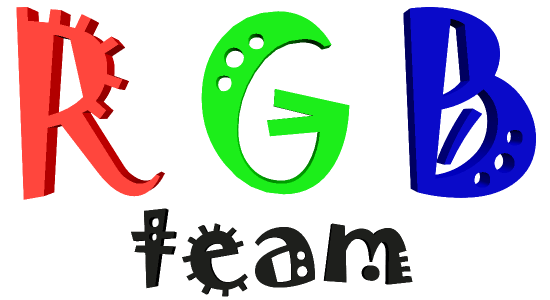
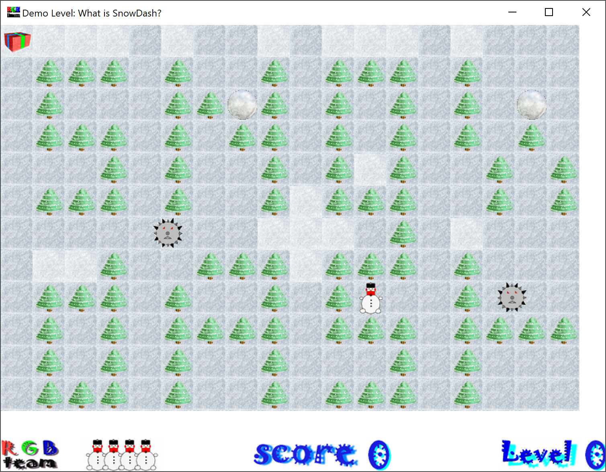
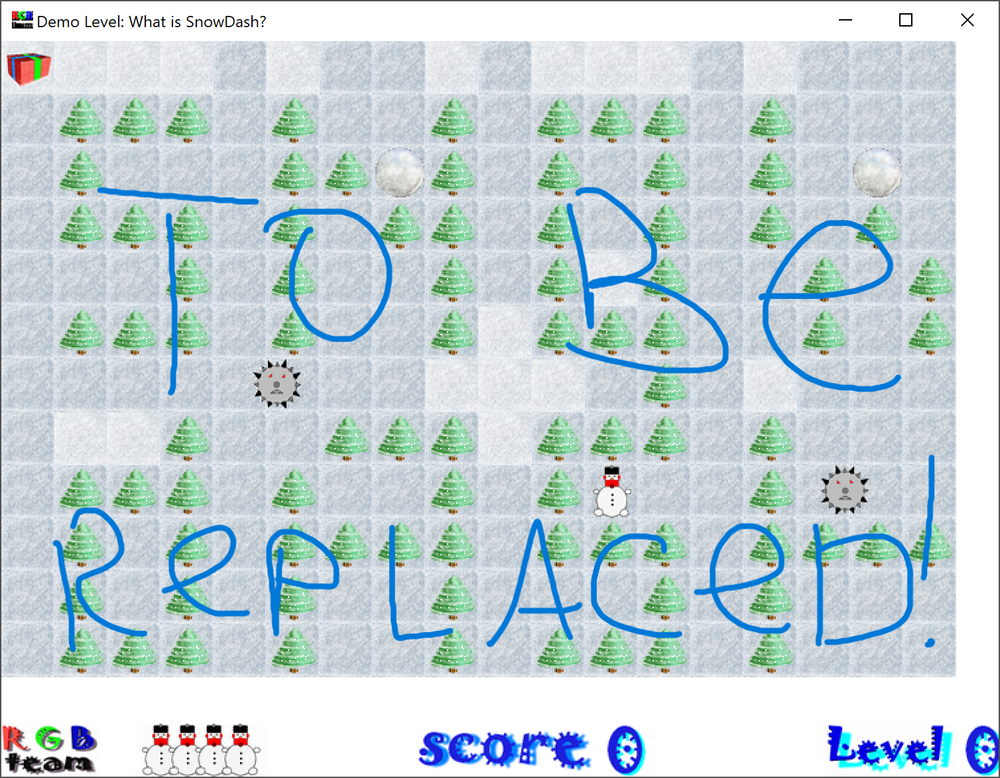
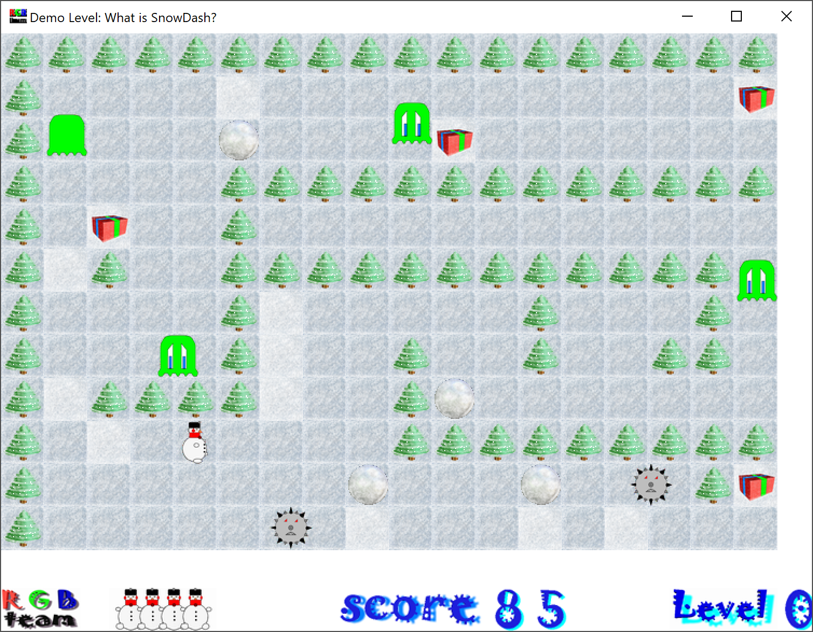
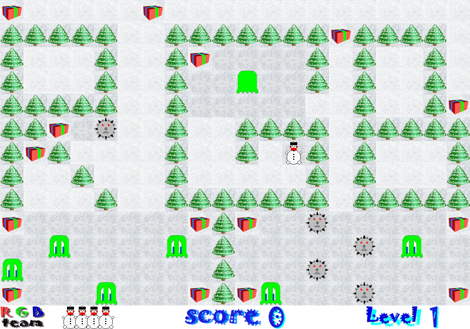

<div align="center">

# ❄️ СнежныйРывок: 20-е Юбилейное Издание

**Web-порт (TypeScript) аркадной игры 2006 года, написанной на Win32 C++ в университете.**

[](https://snowdash20.netlify.app)

 

**[English](README.md)** | **[Русский](README.ru.md)** | **[Post-mortem на русском](misc/RETRO.md)**

</div>

---

## 🙋‍♂️ Здарова заебал!

Это **Dim♂ass♂ik** ("B" из ) 👋

Это специальное web издание супер крутой и всеми любимой игры **СнежныйРывок**. Изначально игра была сделана пацыками 3 курса в далёком 2006 году. Так как игра обрела культовый статус в узких кругах (особенно в одном клубе тех, кто сдал компилятор, IYKYK), и к тому же игре стукнуло 20, я решил запилить web-порт. С помощью ДикПика и Квена Win32 C++ приложение было портировано на TypeScript за пару вечеров (фактически, за неделю; ну да, я нищеброд без Клёёёёта 😢).

## 📜 Немного истории

### 2006

Курс КГ от АМ. Задача: сделать игру или типа того. Собрались с пацанчиками и сделали , названную по нашим английским инициалам. И всё заверте...

<div align="center">
  
  <br>
  <em>СнежныйРывок 2006 ♥</em>
</div>

Тогдашний я отвечал за (по всем вопросам обращайтесь к нему):

- **"Написал" "музыку".** Вся какофония, что слышна в игре — моя вина. "Писалось" всё это в Hip-Hop eJay (крутой DAW)! К сожалению, я просрал все полимеры и оригинальные файлы. Пу-пу-пууу... Так что от 128 kbps MP3 хоть кайфуйте.
- **Подключил FMOD и отвечал за весь звук в игре.** Все SFX были аккуратно нарезаны (там было штук 5+ всяких источников) и сведены в Sound Forge (еще один отличный инструмент).
- **И за весь визуал тоже.** Каждая всратая картинка и "анимация" была отрисована вручную. Я не помню, в чем именно рисовал — скорее всего, в Paint.NET или чем-то столь же простом. Но точно помню, что использовался шрифт Jokerman и крутая программа Ulead COOL 3D. Надеюсь, "кайфанули" от текста на экране Help 😂 Специально картинку оставил (\*кринге\*)

<div align="center">
  
  <br>
  <em>Никакого ИИ! Пруфы :D</em>
</div>

- **15-секундное нескипуемое интро** с медленно ползущими буквами.
- **Прочее** типа уровней (делал тогда в последний момент рандомом), рейтинги, и прочую мелочь, ЕМНИП.

### 2008

На других курсах нам разрешили переиспользовать Снежка. Одним из них был курс "Перспективное ПО" (а у нас тут, между прочим, очень "перспективный" СнежныйРывок). Игру немного отполировали: обновили до последней версии C++, добавили скип на интро, и так по мелочам.

<div align="center">
  
  <br>
  <em>СнежныйРывок 2008. Почувствуй разницу!</em>
</div>

### 2026

Ну раз сейчас время ИИ, то почему бы не попрактиковаться в "написании" TypeScript-приложухи с любимой ИИшечкой, особенно, когда ты с фронтом не-алё? К тому же, игре — двадцатка :D. Совпадение? Не думаю!

К счастью, у меня сохранились все наработки по СнежномуРывку, включая несжатые ассеты (кроме музыки и SFX, увы). Перевёл все BMP картинки в PNG (и сэкономил 5 метров твоего трафика, бро!), а для некоторых картинок пришлось заняться некромантией и воскрешать через одно место Ulead Cool 3D.

## ✨ Что изменилось в веб-версии

<div align="center">
  
  <br>
  <em>СнежныйРывок: 20-е Юбилейное издание. Почувствуй реальную разницу в УЕ</em>
</div>

- **Splash-скрин.** Браузеры не запускают аудио без действия пользователя, так что такой экран стал очень нужен. Сюда же мы и выходим из игры: в Win32 просто закрываешь окно, а в браузере куда можно "Выйти" (кроме как в окно)? Так что `Exit → Splash`.
- **Панельки вокруг канваса.** Добавил Управление и Цели. В универе мы просто объясняли игру вживую. А кому тут объяснять?
- **Оверлей с названием уровня.** В Win32-версии название уровня было в заголовке окна. Здесь же оверлеем перед началом каждого уровня.
- **Прочие кастомные диалоги и оверлеи.** Windows MessageBoxes и алертов нет, поэтому все всплывающие окна сделаны как кастомные оверлеи.
- **Частота тиков 60 Гц.** Оригинал работал на переменных ~64 fps с кучей Sleep'ов; теперь для логики есть фиксированные 60 Гц и 60 FPS для рендера. Стало реально плавно! 🤯
- **Кнопка переключения треков.** Вся моя "гениальная" музыка начинает буквально заёбывать уже через пару минут. Чтобы вы не страдали, я урезал громкость вдвое и добавил переключение треков в игре (N) для разнообразия фона.
- **Все уровни обновлены**, и я прошёл каждый из них по отдельности (но не делал полный прогон игры). Оригиналы нельзя было использовать as is: там последний столбец сетки никогда не заполнялся. Пришлось немного перестраивать и подстраивать уровни.
- **Рандомные начальные направления** у врагов. В оригинале монстры всегда стартовали в одном заданном направлении, что оказалось немного неудобно для левел-дизайна.
- **Мелкие фиксы багов** тут и там — но общий визуальный дизайн и ощущения игры остались как в 2006 году.

## 🎉 Поигрались и хватит

Наконец-то закрыт гештальт по Снежку.

Спасибо за игру (если кто-то вообще будет в ЭТО играть)

Всем чмоки,  
**Dim♂ass♂ik**

## 🎮 Игра

### Цели

Это. Не. Можыд. Быт. Дед Мороз потерял все сладкие подарочки! Помоги ему, **господин Снежок**!

- **Чтобы победить**: Собери все подарки на уровне.
- **Помоги себе сам**: Поешь снег, чтобы расчистить путь. Сталкивай камни с уступов, чтобы давить монстров.
- **Осторожно**: Любой монстр убивает при касании. Как и падающий камень.
- **Жизни**: У тебя их 4 и все жизни Снежка важны. Каждая смерть перезапускает уровень (включая собранные подарочки). Потеряешь все — всё, игра окончена.

### Управление

| Ключ                  | Действие                      |
| :-------------------- | :---------------------------- |
| `Ц Ф Ы В` / `⬆ ⬅ ⬇ ➡` | Движение                      |
| `З` / `Отм`           | Пауза (в игре)                |
| `К`                   | Перезагрузка уровня (−200Очк) |
| `Ь`                   | Выключить звук                |
| `Т`                   | Следующий трек                |

## 🛠️ Технические Детали

### Стек

- TypeScript, без сторонних фреймворков
- Canvas 2D API
- Vite (vanilla-ts)
- Деплой: GitHub Pages / Netlify

### Как запустить локально

```bash
git clone https://github.com/dmibbb/snowdash20.git
cd snowdash20
npm install
npm run dev
```

<div align="center">Сделал с ♥ <a href="https://github.com/dmibbb" target="_blank" rel="noopener noreferrer">Dim♂ass♂ik</a> в 2026</div>
