

# 👴 СнежныйРывок: Post-mortem Портирования Бессмертной Классики

**[English](../README.md)** | **[Русский](../README.ru.md)** | **[Post-mortem на русском](RETRO.md)**

> **TL;DR.** Пост-мортем перевода студенческой игры на `C++/Win32/GDI` 2006 года с нуля на `TypeScript/HTML5 Canvas/Vite/Netlify`, преимущественно с помощью AI-ассистентов (DeepSeek, Qwen, Google AI mode). Ниже — что делал, зачем, как, почему и т.п. Про саму игру, краткую историю создания и отличия от оригинала можно почитать в README по ссылкам выше ☝☝☝. Там всё точь-в-точь, что есть в "About this port"-футере страницы самой игры.

## Исходная точка

### Что было в 2006 году

В рамках курса по "Компьютерной графике" в 2006 году была сделана **легендарная игра Snowdash** командой из троих студентов (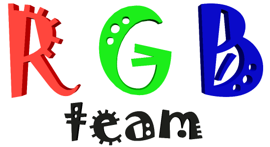).

**SnowDash** — аркадная 2D-игра с видом сверху на сетке 20×13. Игрок (Mr. Snejok) ходит по клеткам, ест снег, собирает подарочки, толкает камни, убегает от монстров.

Игра была написана на `C++` (MSVC 2003 → 2006/2008) для Windows с использованием: `Win32 API`, `GDI` для рендера (окно ~800×600), `FMOD 3.75` для звука и музыки, BMP-спрайтами с отдельными монохромными масками. Тик (один цикл обновления состояния игры) как таковой отсутствовал: главный цикл использовал `Sleep(10)`, что давало переменный ~50–70 FPS в зависимости от загрузки проца.

В 2026 оригинальный `.exe` всё ещё запускался, но стартовал с ошибками, утекал по памяти из-за некорректной очистки GDI-хендлов и постоянной перезагрузки звуков в память. Более того, игра падала, если камень падал на самую нижнюю видимую игровую строку.

  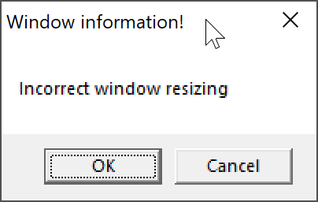
   
  <em>Кажется что-то пошло не так...</em>

### Идея порта

В мае 2026 года я активно игрался с ИИ с точки зрения разработки. До этого я использовал нейросети только по мелочи, а тут решил полноценно заиспользовать.

Я попробовал запилить самую простую вещь для бэкэнд-разработчика, которая тогда пришла в голову: игру `Sudoku` на чистом `JavaScript+HTML+CSS`. Крутые локальные модели не подошли, потому что у моей видеокарты слишком мало памяти (да, я нищеброд!). А те маленькие, что доступны, требуют кучи корректной обвязки, работают медленно, а иногда вообще ничего не отвечают или отдают пустой JSON.

В общем, от локальных моделей я отказался и перешёл на облачные. Я был потрясён (\*я_ахренел_просто_мем.png\*) тем, как быстро, легко и просто всё это делается с помощью `DeepSeek`, `Cursor` (сжёг половину токенов на первом же запросе, лол), `Qwen` (+ тот же `Qwen Coder`, пока он был доступен) и других подобных бесплатных инструментов (да, я не могу позволить себе `Клёёёт`).

Ради прикола я взял исходники Снежка (C++, ~2000 строк) и скормил их Квену и Дикпику, не объясняя, что это. Просто написал в чате: _«Check sources. What is it all about? Can it be moved to web application?»_. И китайские братишки мне всё рассказали: описали, о чём эта игра, как устроена изнутри, какие игровые механики в ней используются и что её можно очень легко переписать под веб (`TypeScript`/`JavaScript`).

> _"Да, это маленькая игра, бэкендеру по силам. Реализация займёт по вечерам — 3–5 недель, фултайм — 1.5–2 недели. Главный риск: нет эталонной сборки для сравнения поведения. Тонкие баги в физике камней и ИИ монстров можно не заметить. Лучше писать с нуля, а не портировать дословно. 70% оригинального кода — это Win32-обвязка, которую всё равно пришлось бы выбросить."_ — вольный пересказ ответа DeepSeek-брата

`Qwen`-брат тоже разложил всё по-полочкам, рассказал, что легко перенесётся, что придётся выкинуть, выявил архитектурные проблемы старого кода, и на сладкое предложил несколько вариантов реализации от ванильного `JS` до `WebAssembly` и `Godot` 🙄.

Осенью я вспомнил, что в 2026 году **Snowdash** исполняется двадцать лет 🎂. Так почему бы реально не сделать специальное юбилейное веб-издание? И потекло говно по трубам!

## Реализация

### Этап 0: Концепция и Архитектура

Так как денег нет (держусь!) на навороченные ИИ-модели, **вся разработка велась без агентов**, в стиле 25-го года (т.е. **через окно чата с копипастой кода**).

Прежде чем писать хоть строчку кода, пришлось потратить время на подготовку **документации**. Несмотря на то, что Квен и Дикпик довольно-таки неплохо держат контекст в рамках одной чатовой сессии, это было **ключевое решение** — без него AI вскоре начал бы "забывать", что мы делали пару дней назад. Более того, гораздо удобнее перекидываться файлами между моделями, чем каждый раз что-то там пытаться объяснить.

Я опять скормил сорсники китайским братьям `Qwen` и `DeepSeek`. Дикпик сделал первый набросок дизайн-документа (по сути, технической спеки), который я скормил Квену. Квен поморщился и включил свой ультра-придирчивый режим, выдав кучу исправлений и неточностей, и с этим я пошел уже к Дикпику. И пошло отлупливание с уточнениями и предложениями от Дикпика к Квену, от Квена к Дикпику и так далее. В итоге, мы согласовали **[спеку](SPEC.md)**.

`DeepSeek` сделал первый набросок огромного списка задач (40 подзадач с DoD), с которым я пошёл к брату `Qwen`. Вместе с ним мы уже разбили всё по фазам и сформировали **[список задач](Tasks.md)**. И я опять начал гонять Барсиков друг другу 😹

Из интересного, Дикпик предложил использовать ещё один файл — **[PROJECT_CONTEXT.md](PROJECT_CONTEXT.md)** — раз у нас разработка идёт с помощью ИИ. Естественно, я опять погонял ~~лысого~~ китайских братьев, прежде чем сформировался адекватный файл. При разработке этот файл обновлялся после каждой фазы и периодически подавался в чат.

> ✍ **Хозяйке на заметку!** _"Вместо ручного копипаста в PROJECT_CONTEXT.md, можно попробовать бесплатные инструменты вроде Continue.dev (плагин для VS Code) или Aider (консольный ИИ-ассистент). Они умеют "читать" вашу кодовую базу и файлы спецификаций, не выходя за лимиты контекста, и сами подтягивают нужные куски кода в промпт. Это сэкономит кучу времени на "пересказе" состояния проекта."_ — Qwen-брат, прочитав ретро

Сформировав финальный список задач, я закинул его в свою локальную [`Vikunja`](https://vikunja.io/), на которую переполз летом. Но, по факту, использовал **[Tasks.md](Tasks.md)** как основной.

### План разработки

В итоге, получились вот такие фазы:

| #   | Этап                      | Даты                    |
| --- | ------------------------- | ----------------------- |
| 1   | Setup & Skeleton          | 2026-11-06              |
| 2   | Player on Empty Grid      | 2026-11-06              |
| 3   | Level Loading & Walls     | 2026-11-06              |
| 4   | Tiles Interactions        | 2026-11-09              |
| 5   | Stones                    | 2026-11-09              |
| 6   | Monsters                  | 2026-11-09              |
| 7   | Game State & Progression  | 2026-11-10              |
| 8   | UI — HUD, Pause, Modes    | 2026-11-10              |
| 9   | Sound                     | 2026-11-10              |
| 10  | Real Assets               | 2026-11-11              |
| 11  | Tests, ~~Polish, Deploy~~ | 2026-11-11              |
| 12  | Known Issues & Polish     | 2026-11-11 — 2026-11-13 |
| 13  | Deploy                    | 2026-11-13              |

### Этапы 1-11: Ядро игры

Так как с **дорогим БРАТОМ** `Qwen` я уже накодил пару Kotlin-приложух на телефон, в этот раз решил попробовать разработку с **дорогим БРАТОМ** `DeepSeek`.

Первым делом мы сформировали команду разработки:

- `DeepSeek` стал основным разработчиком;
- `Qwen` иногда помогал исправлять проблемы, с которыми его брат тупил;
- `Google AI Mode` использовался по мелочи, когда надо было получить быстрый ответ.

За первый день навалили базы:

- **Фаза 1 (Setup & Skeleton)**. Vite + TypeScript + ESLint + Prettier. Пустой канвас 800×600, requestAnimationFrame-цикл с аккумулятором 50 мс. Никакой логики — только скелет. Цель: убедиться, что сборка работает, DevTools чистый, тик вызывается 20 раз в секунду.

- **Фаза 2 (Player on Empty Grid)**. Игрок-синий квадрат 40×40, движение по клеткам через клавиатуру, границы карты. Edge-триггеры vs continuous-ввод — разделили сразу, чтобы потом не переделывать.

- **Фаза 3 (Level Loading & Walls)**. Парсер уровней (поддерживает BOM, пустые строки, lowercase + дефис).

После фазы 3 уже можно было ходить по карте. Первый уровень игры стал выглядеть примерно как на картинке ниже.

  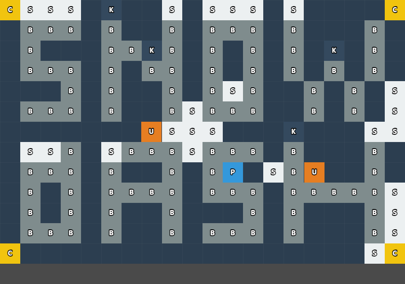
   
  <em>SnowDash: Tiles Edition. Level 1</em>

Далее перешли к геймплею:

- **Фаза 4 (Tiles Interactions)**. Игрок ест снег, собирает подарочки, счёт растёт. Первый полноценный геймплейный цикл — можно было "пройти" уровень, собрав все сундуки.

- **Фаза 5 (Stones)**. Самая сложная фаза по механике. Камень должен корректно падать; скатываться вбок, если под ним другой камень; толкаться игроком; убивать игрока и монстров при падении.

- **Фаза 6 (Monsters)**. Блуждание, проверка коллизий, урон игроку.

- **Фаза 7 (Game State & Progression)**. Жизни, рестарт уровня, переход между уровнями, рейтинг, Game Over. Игра стала "закольцована": можно пройти все уровни и увидеть финальный экран.

После фазы 7 игра была полностью играбельной — но без UI, звука и с разноцветными квадратами вместо спрайтов.

**Восьмой этап (UI — HUD, Pause, Modes)** вышел самым большим запланированным этапом по объёму. Мы с **дорогим БРАТОМ** `DeepSeek` разбили её на 4 подфазы:

- 8.1. HUD со спрайтами цифр и иконок.
- 8.2. FSM (ModeMachine) для управления экранами.
- 8.3. Оверлеи паузы, About, Exit.
- 8.4. Главное меню с кнопками, hit-test кликов, hover.

Стейт-машина стала одним из лучших архитектурных решений для игры. Каждый режим (типа intro, menu, playing, gameover) был вынесен в отдельный файл в `modes/`, возвращающий нужные хуки. Добавление нового режима стало делом 5-10 минут.

В **этапе 9 (Sound)** сделали `AudioManager` на `HTMLAudioElement`. Пул аудио-элементов на каждый SFX, чтобы один звук мог играть несколько раз одновременно. Музыка и SFX были взяты из игры 2006 года как есть (128 kbps MP3 🙉), так как у меня не сохранились оригиналы ни Hip-Hop eJay файлов, ни источники звуков.

> 🤣 **Fun fact**. В игре используются сэмплы: - мультфильм "Новоселье у Братца Кролика" (1986), - Queen — We are the Champions, - Фридерик Шопен — Траурный марш, - голос Гомера Симпсона из The Simpsons, - прочая мелочь из готового набора звуков, что валялся на компе 2006 года.

На **этапе 10 (Real Assets)** перешли к подключению картинок. Большинство спрайтов оригинальной игры представляли собой пары `name.bmp` + `name_m.bmp` (монохромная маска). В Win32 `MaskBlt` использовал эту маску для прозрачности. В 2026 такой подход кажется странным и в веб-версии нам нужен PNG с альфа-каналом.

  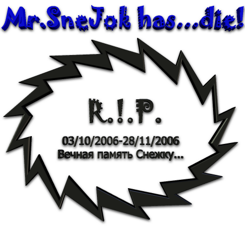&nbsp;&nbsp;
  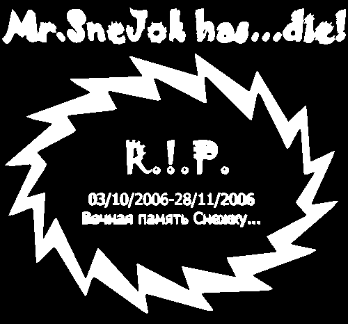
   
  <em>Кринжовый RIP-скрин и его маска из игры 2006 года</em>

На данном этапе решил оставить BMP, чтобы посмотреть, как всё вместе выглядит. Переход на PNG отложил на конец. Заодно нашёл косяки с UI: проблемы с масками, отсутствие прозрачности каких-то элементов, отсутствие каких-то картинок, которые были ненужны в Win32-версии.

**Этап 11 (Tests, Polish, Deploy)** решил ограничить только тестами, полишинг и деплой отложил на потом. 70+ юнит-тестов на `Vitest` (**99 тестов** на момент написания ретро). Покрыли парсер уровней, сам уровень, сущности игры (Player, Stone, Monster) и саму игру, а также добавили интеграционный тест "пройти уровень от начала до конца". В дальнейшем, тесты очень хорошо помогали отлавливать проблемы, особенно при миграции на 60 Hz.

### Полишинг

С полишингом случилась классика 80/20: всё, что было сделано до него (~80% работы) заняло 20% времени. А вот наведение финальной красоты заняло большую часть времени.

Отмечу ниже детально лишь крупные изменения и те, которые сожрали много времени.

#### Splash

Главная проблема веб-версии — `Autoplay Policy` браузеров. Музыка не играет до первого действия пользователя (клик, жест, касание, нажатие кнопки).

  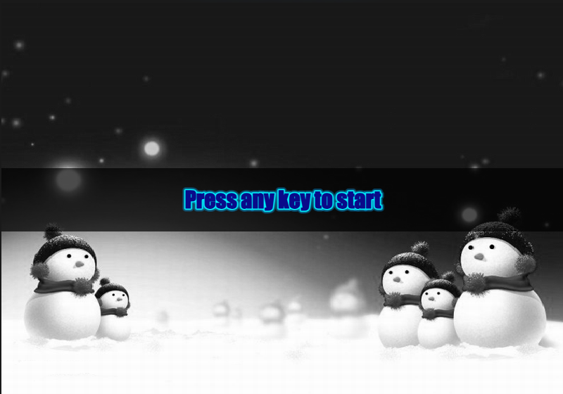
   
  <em>Splash screen</em>

В качестве решения сделали простой splash screen с "Press any key" по центру в цветах игры, который вызывает `audio.unlock()`. Заодно этот экран пригодился и как экран выхода.

#### Оверлеи

Win32-версия активно использует диалоговые окна для отображения информации (секция About, прохождение уровня). Для web-версии пришлось делать встроенный оверлей и добавлять на экраны About, Exit, RIP, завершения уровня и всей игры.

  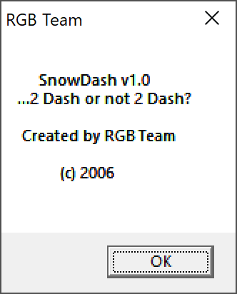&nbsp;&nbsp;
  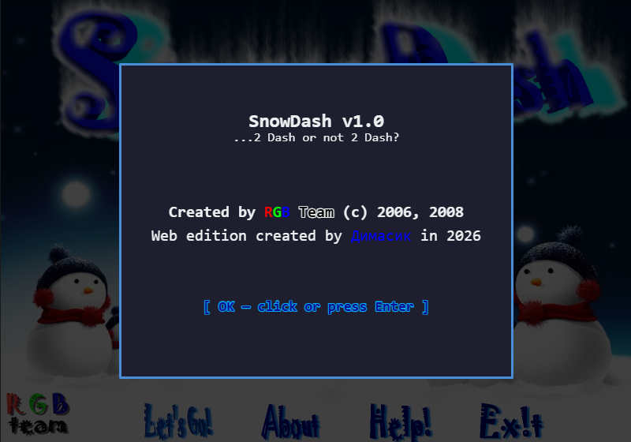
   
  <em>About: 2006 vs 2026</em>

#### Главная страница

В честь такого порта главную страницу было грешновато оставлять без украшения. В итоге добавили:

- **слева**: секцию управления, т.к. в игре нигде не говорится, как управлять (когда мы сдавали игру в универе, мы это рассказывали словами через рот);
- **справа**: краткое описание игры, т.к. опять же, в игре нигде не говорится, что надо сделать;
- **снизу**: классический made by Димасик, который я включаю в каждую свою поделку;
- **сверху**: просто шикарный ледяно-огненный тайтл, но до классики шрифтом Jokerman ему, конечно, далеко.

  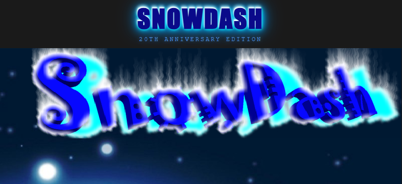
   
  <em>Какой хэдэр лучше?</em>

Практически перед запланированным релизом я подумал о некоторых дополнительных улучшениях, которые неплохо было бы добавить. Так вначале появилась секция About, в которой с шутками-прибаутками кратко рассказывается об основной идее создания этого порта, что было сделано, как улучшено (всё это скопировано в **[README](../README.md)** / **[ПРОЧТИМЕНЯ](../README.ru.md)**).

> 🤣 **Fun fact**. Первоначально, карандашный рисунок из "About this port" был отсканирован в 2006 году и использовался как база для картинок игрока и врагов.

Но простыми словами дело не ограничилось. Возникли ещё идеи, которые, оказалось, достаточно легко реализовать:

- **Языковая поддержка**. Переписал английскую версию "About this port" на русский и добавил простой переключатель.
- **Сравнение версий**. Оказывается, слайдер для сравнения картинок делается буквально за 10 строчек JS и под сотню строк CSS 🤯.
- **Тёмная / светлая тема**. Но это осталось только в рамках чата с братишками, т.к. пришлось бы долго возиться с подборкой цветов под светлую тему.

#### Картинки

Самое веселье было со спрайтами, которые надо было перевести с BMP на PNG. Здесь я, наверное, часов 8 убил.

Так как они были маленькими (40х40), то маска через Magic wand получалась сильно кривая. Не спасали ни игры с Tolerance палочки, ни даже фильтр Гаусса, добавленный отдельным слоем для смягчения углов. 40х40 — это уже какой-то pixel-art!

К счастью, у меня были оригиналы картинок в архиве с игрой. В ней нашлись крупные рисунки игрока и врагов, ёлки, камни, фоны.

  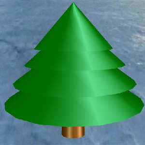&nbsp;&nbsp;
  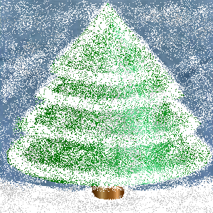&nbsp;&nbsp;
  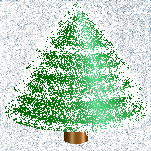
   
  <em>Выбери ёлочку</em>

Однако нельзя так просто взять крупный оригинал, удалить лишний задник, ресайзнуть картинку (даже в несколько этапов), немного увеличить резкость и получить супер-пупер иконку (\*боромир.пнг\*). Всё равно лезли артефакты по краям, и оригинал 2006-го всё-равно смотрелся лучше.

Пришлось заниматься попиксельной правкой в `Paint.Net` с карандашом и резинкой. А так как у игрока (3 картинки на 4 направления) и у монстров по 12 картинок (2 картинки на направление, а шипастик ходит только горизонтально), то, цитируя `JSON Стэтхэма`, одна ошибка в цвете — и ты ошибся! ©

В итоге, с горем пополам кое-как перерисовал Снежка. Прочистил оригиналы для Амёбы со Спайкером и немножко подкрасил. Вроде стало выглядеть чуть лучше 🤷‍♂️.

> ✍ **Хозяйке на заметку!** _"В будущем для таких задач стоит попробовать бесплатные нейросетевые инструменты для сегментации (например, RMBG-2.0 или BiRefNet, которые можно запустить локально или через бесплатные демо на Hugging Face). Они справляются с пиксель-артом и монохромными масками гораздо лучше "волшебной палочки", даже на низком разрешении."_ — Qwen-брат, прочитав ретро

Но на этом веселье с картинками, разумеется, не заканчивается. Оригинальная папка содержала файлы с неким расширением `.c3d`. Оказалось, что это расширение древнего, как говно мамонта, приложения `Ulead Cool 3D`. И именно в нем были сделаны все надписи в меню, на главной картинке, в самой игре на HUDе и в других местах. И самое веселье, что разработчика приложения купила Corel в декабре 2006 года и перестала поддерживать приложение.

> 🤣 **Fun fact**. Папка с оригиналами картинок лежала рядом с исходниками игры в файле appendix.rar и носила очень оригинальное название "\_рабочее гавно\_" 🤦‍♂️

К счастью на просторах интернета есть спасительная 15-дневная триалка, но и на этом безудержное веселье с ней не заканчивается.

- Во 1), шрифт, который использовался, в системе отсутствует. Поэтому все надписи писались условным Arial.
- Вовторых, сам шрифт `Jokerman`, которым всё написано, проприетарный. Пришлось его "одолжить" и сконвертировать из otf в ttf, чтобы Ulead его понял.
- 3), триалка сдохла при первом перезапуске. Благо верный помощник `Google AI Mode` поделился секретиком в виде приложения `RunAsDate` 🙄.

Кое-как удалось завести триалку и по-быстрому сделать свои грязные дела: экспортнуть нужные картинки с прозрачным фоном в формат `TGA`, который я потом уже конвертировал в `PNG`.

#### Misc

Прочие изменения кратко:

- **Переход на 60Hz**. Тут пришлось довольно-таки много чего переписывать братишкам, зато у нас получилось чуть плавнее отрисовываться. Вкратце, поменялась немного математика с целочисленного на плавущую точку. В результате этого возник прикольный баг: при толкании камня слева направо, игрок мгновенно погибал из-за ошибки округления. Обсчитывая матрицу, игра считала, что между игроком и камнем возникает коллизия и игрока как бы раздавил камень.

- **Название уровней**. В оригинале они прописывались в коде и показывались в заголовке окна исходя от номера уровня. В веб-версии запихнул название в файл уровня, а отображение сделал оверлеем на пару секунд перед началом уровня.

- **Редизайн уровней**. Если внимательно посмотреть на оригинальные скриншоты игры 2006 года, то можно заметить, что самого правого столбца и самой нижней строчки нету. Это всё потому, что кто-то проебался 😮, ведь даже файл уровней (`.lvl`) не поддерживает последний столбец и крашит старт (уровни веб-версии и оригинала теперь несовместимы). Поэтому пришлось где-то что-то добавлять, чтобы крайний столбец нормально смотрелся. Заодно прошёл все уровни один за другим по одному, местами полностью исправляя весь дизайн.

- **Рестарт уровня**. Изначально я даже не знал, что в оригинальном приложении есть рестарт (`Z`). Чтобы избежать софт лока, в меню паузы была добавлена опция рестарта. Случайно обнаружив такую возможность в оригинале, рестарт уровня был выкинут из меню и вынесен на хоткей (`R`).

- **Фоновая музыка**. Так как музыка стартовала при начале уровня всегда одна и та же, она мне очень быстро надоела и пришлось придумывать разнообразие. Для начала громкость была уменьшена до 75%, а в финале до 50%. А потом появился хоткей (`N`) для смены треков.

> 🤣 **Fun fact**. Вся музыка была написана профессиональным продюсером Димасиком на профессиональном оборудовании в профессиональном приложении Hip-Hop eJay 💽 (_всё кроме приложения неправда_)

- **Экранные подсказки**. Добавлены экранные подсказки, типа `Press any key` тут и там.

- **Мелкий баг фикс** всякого разного. Например, пофиксена физика камня:

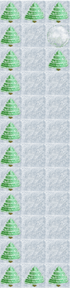&nbsp;&nbsp;
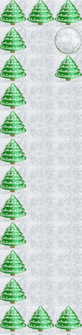
   
  <em>Камнепад 2006 vs Камнепад 2026</em>

#### Post-release правки

Получив первый фидбэк на релизную версию, быстренько с **дорогим БРАТОМ** `DeepSeek` добавили экранный `D-Pad`, чтобы работало на айпадах и мобильных телефонах без регистрации и SMS 📳.

## Деплой

ИИшки предлагали несколько вариантов сервисов для деплоя: `Netlify`, `Cloudflare Pages`, `GitHub Pages`, `Vercel`. Про большинство из них писалось, что РКН блокирует некоторые их подсети. Но, по крайней мере, у меня Netlify открывался, поэтому пошёл с ним.

Задеплоилось всё легко и просто, буквально раз и готово. Зашёл на [Netlify](https://app.netlify.com/) через `GitHub`, указал приватную репу, он сам всё понял, собрал, поднял, обнял, приподнял и выкатил превью версию. Сделал smoke/sanity тесты с превьюшкой и — вжух! — игра доступна всем на [https://snowdash20.netlify.app](https://snowdash20.netlify.app) 💃🥳🎊

Если вы читаете этот документ, значит на `GitHub Pages` это тоже было выложено (но это не точно!).

## Итоги

- **Попробовал для себя TypeScript** в действии. Мне понравилось 😊 _#happyhappyjoyjoy_
- **Попробовал для себя написание игр**. Мне понравилось (особенно, когда за тебя пишут весь говнокод). Но объём кода вырос с ~2000 строк (C++) до ~6000 строк (TS), включая тесты. Оно и понятно, одна CSS-ка под 500+ строк. Ждем `СнежныйРывок 2: Месть Снежка` ⛄
- **Попробовал для себя "pixel-art"**. Мне понравилось, но это очень долго с моим текущим уровнем. А нормальные ИИшки для генерации картинок стоят денег.
- **Перенос логики оказался гораздо проще, чем перенос графики**.
- **Фаза подготовки — самый важный этап**. Особенно стоит потратить время на написание детальной спеки. Китайские братья в своих размышлениях очень часто ссылались на спеку и на конфликты с ней, прежде чем выдать мне код.
- **Старые исходники тоже можно подгрузить моделям** и использовать исключительно как справочник механик и уровней.
- DeepSeek изначально оценил работу по вечерам в 3–5 недель, а по факту **от старта до деплоя ушла всего неделя**. Хорошая спека ускоряет пет-проекты, даже без дорогих агентских IDE.
- **Файл с контекстом хорошо помог при реализации**, выставив все необходимые ограничения и правила для ИИ. Хотя файл содержит огромное количество лишней информации и может быть значительно сокращен, если предполагается использование только одной модели. Но для безагентных нищебродов очень даже неплохое решение.
- **Правильная разбивка на короткие задачи** очень сильно помогает избежать огромного количества генерированного кода. Что в свою очередь позволяет понимать, что вообще происходит.
- **Тесты важны**. Хоть не всё ими в проекте покрыто и писались они довольно-таки в поздней фазе разработки, но они всё равно помогли избежать более поздних проблем.
- **Больше интеграционных тестов с самого начала**.
- **Важно сохранять все ассеты и наработки в какой-нибудь папке**, типа "_рабочий материал_". Никогда не знаешь, когда они пригодятся.
- **Бесплатные китайские братья приходят с ограничениями**. Например, брат DeepSeek очень сильно тупил на математике и подсчётах. Особенно когда начинались сложные баги: он начинал всё считать, думал пару минут, останавливался, Continue, думал ещё пару минут, опять останавливался и т.д. Один раз после долгих раздумий в итоге выдал "Length limit reached. Please start a new chat.", намертво убив чат. Хорошо, что были файлы с документацией, с которыми всё очень легко перенести и продолжить в новом чате. По моему опыту с братом Qwen в других поделках, он в среднем над кодом думает дольше (может сейчас так форсят на платный тариф или юзверей много набежало 🤷‍♂️), но тут баги игры правил гораздо быстрее, чем его брат.

> ✍ **Хозяйке на заметку!** _"Борьба с "тупкой" ИИ на математике: Когда DeepSeek или Qwen начинают "думать" и спотыкаться на расчётах, помогите им, заставив писать чистые функции без сайд-эффектов и сразу требуйте от них написания юнит-теста для этой функции в том же ответе. ИИ гораздо лучше пишет код, когда сразу видит, как этот код будет проверяться (Test-Driven Generation)."_ — Qwen-брат, прочитав ретро

Сделано с ♥ <a href="https://github.com/dmibbb" target="_blank" rel="noopener noreferrer">Димасиком</a> 14 ноября 2026

